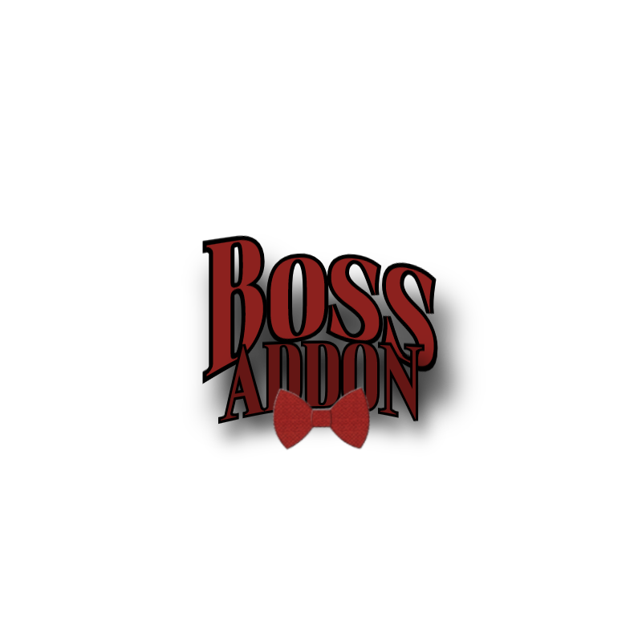

<p align="center">
  
</p>

<p align="center"><sub>Logo by @WaterBoss11</sub></p>

# BossAddon

> An open-source PvP + utility addon for AUTISM Client on Minecraft 26.2 — the merged home of
> **Boss's PVP** (combat) and **BossUtility** (QoL/utility), each toggleable as a half via
> `?bossaddon pvp|utility on|off`.

[](LICENSE)


[](https://github.com/WaterBoss11/BossAddon/releases/latest)
[](https://github.com/WaterBoss11/BossAddon/issues)

BossAddon complements the main client's combat modules instead of registering duplicate auras,
armor/totem managers, scaffold, or overlapping render controls. This version has **53 modules across its two halves** (41 PvP + 12 utility),
including the existing guards/reporting controls, and eight HUD providers. It adds **20 modules** and
upgrades AutoWeapon, AutoHook, AutoShoot, and InvManager. **AutoClutch is intentionally retained.**

New modules start **disabled**. Existing settings and enabled states are retained for surviving modules.
Use only one BossAddon jar at a time, matched to the host version below.

> [!WARNING]
> Server rules and server-side validation still apply. Experimental movement can be rejected or corrected;
> no anticheat compatibility is guaranteed. Test settings in a local world before using them elsewhere.

## New optimization: Item Render Cap

**BossUtility → Item Render Cap** is a disabled-by-default port from
[Boss Optimizations](https://github.com/WaterBoss11/boss-optimizations/tree/6707d67b15741fe9c36d94a1356e7c78ef9d9780).
It rejects excess dropped-item renders before render-state extraction; it does not remove items,
change their state, send packets, or alter ticking, picking, pickup, merging or despawning.

- **Items per cell:** default **5**, configurable **0–128**. Zero hides all but the crosshair exemption.
- **Cell width:** default **4 blocks**, configurable **0.5–128**. Cells are grid-aligned cubes, not radius groups.
  Full coordinate tuples keep cells independent, fixing an inherited hash collision between mirrored cells.
- Higher entity IDs win, favoring newer drops while server IDs increase normally. An aimed-at item within
  the donor's 32-block visual ray is exempt and can add **one extra item**. This ray ignores walls and does
  not modify Minecraft's hit result. Selection includes offscreen items.
- Membership and settings are snapshotted once per extraction frame, never on a timer or midway through
  item queries. Enable/disable, disconnect and world replacement clear stale selection.
- Disabling the utility half makes it inert immediately. Turning the half back on restores only previously
  enabled modules, without changing their settings or any host/PvP modules.
- If standalone Fabric mod **`bossoptimizations`** is installed, the addon cap does **no selection work**,
  even if that mod's cap is disabled. Configure one owner; no donor settings are read or changed.

This trades a per-frame item scan/ray test for fewer extracted/rendered item states in dense piles.
**No FPS improvement is promised or benchmarked.** Moving items crossing cell boundaries can still change
selection; Sodium/Iris combinations and native gameplay have not been verified for this port.
The donor's full MIT notice is packaged with BossAddon; the addon remains GPL-3.0.

## New movement modules

| Module | Behavior |
|---|---|
| AutoWindCharge | Deliberate jump/key-triggered wind-charge assistance with landing and cooldown checks |
| KeepSprint | Retains attack momentum; yields to conflicting critical-hit/sprint-reset settings |
| HoleSnap | Moves toward a nearby unoccupied, reachable resistant hole |
| TargetStrafe | Orbits an eligible target with collision and ledge checks |
| FastWeb | Configurable web slowdown/escape handling |
| FastLadder | Faster ladder/vine ascent, with climbable and headroom checks |
| WaterWalk | Experimental liquid-surface movement; sneak to descend, no fire/lava immunity |
| ReverseStep | Faster bounded descents, without overriding intentional jumps or fall protection |
| TridentBoost | Experimental boost of real water/rain Riptide impulses; no dry-land guarantee |
| ElytraPursuit | Target-relative steering while already gliding, with collision/separation checks |

Movement controllers yield rather than all steering at once. Host Flight, Speed, Sprint, Scaffold,
SafeWalk, and InvMove remain the main client's responsibility.

## New combat, defense, and ranged helpers

| Module | Behavior |
|---|---|
| ClickPearl | One pearl attempt per configured hotkey press; restores the previous slot |
| PearlChaser | Follows an identified enemy pearl toward a supported, clear landing; unknown owners are skipped |
| AutoShield | Uses an already-equipped shield against nearby threats; does not move offhand items |
| AntiFireball | Deflects incoming vanilla large fireballs within actual attack reach |
| BowRelease | Releases a manually drawn bow/trident using its actual charge ticks |
| SpearAssist | Kinetic-weapon charge/timing assistance; experimental lunge is restricted to an integrated local server |
| PistonPush | Bounded piston/power placement with server-confirmed state transitions |
| CityMine | Opponent-surround block selection using native mining, not another packet-mining engine |

ClickPearl's action key is unbound until configured. BowRelease requires physical use input by default.
PearlChaser skips fluid/unloaded/unsafe predictions instead of guessing a destination. AutoShield releases
only its own use input and yields when the player takes over.

## AutoMace

**AutoMace is a separate, disabled-by-default module**, not a rename of AutoWeapon. It attacks during a real
native mace-smash fall; it does not fake fall height or force server attributes.

- **Actual AUTISM AimAssist logic:** the installed host's own AimAssist executes through the stable module
  callbacks. No replacement approximation is used. Choose the host's existing settings or AutoMace-specific
  FOV, range, target point, axes, priority, deadzone, smoothing speeds, direction factor and midpoint.
  Human mode uses V4's real implementation; API v3 uses its native interpolation. An already-enabled host
  AimAssist keeps control. AutoMace neither enables it automatically nor overwrites its saved settings;
  custom overrides exist only inside the borrowed aim tick and are restored even if that tick fails.
- **Smash controls:** fall-distance window, descent speed, optional held attack/activation bind, preparation
  during ascent, charge requirement, repeat interval, one hit per fall, health floor and bounded timeout.
- **Mace selection:** fixed or automatic hotbar slot, native damage ranking, or Density/Breach/Wind Burst
  preference; optional automatic switching and slot restoration.
- **Axe stun slam:** independently toggle the axe-first shield attack, axe slot, charge/hold requirement,
  follow-up delay and shield-lowering confirmation. The separate experimental **axe attribute swap** option
  holds a prepared axe until the real aligned, in-range smash window, then swaps for that strike.
  The isolated vanilla test observed the mace retaining the axe's native damage attribute for that hit;
  timing-dependent benefits on other servers remain experimental.
- **Spear reach swap:** optionally use a real spear jab at its native reach and then switch to mace once a
  mace hit is legal. Spear slot, preparation hold and the extra jab are configurable. Vanilla 26.2 stores
  spear reach on the held item's attack-range component: **swapping cannot legitimately grant that range
  to a mace**. No fake extended-range success is reported. A spear jab is vetoed if its line would also
  pierce a protected friend or an unselected living target.
- **Spear swap for auto lunge:** separately enable automatic selection of a **Lunge-enchanted** spear and
  a native jab that triggers the server's dash. Configure target range, cooldown, hunger floor, forward
  clearance, approach-only behavior and optional ground activation. The spear is held through real equipment/
  charge readiness and the previous slot is restored after the request; airborne sequences can follow with
  the mace only at legal mace range. Lunge strength, exhaustion and durability come from the real enchantment,
  not invented velocity. Unenchanted spears, low hunger, blocked/protected paths or a disabled ground option
  do not trigger an automatic lunge. This option is off by default.

Each action checks real aim/visibility/weapon reach and friend protection. Higher-priority item use,
manual slot/item changes, GUI opening, invalid targets, landing or timeout cancel the owned sequence.
AutoWeapon does not replace the axe/mace during AutoMace's own accepted attack.
## Retained modules and upgrades

- **Combat:** BedAura, HoleFiller, AutoWeapon, Reach, AntiEntityPush, AutoShoot.
- **Automation:** AutoPot, AutoGap, AutoHook, InvManager, **AutoClutch**, AutoLeave, Hitbox.
- **Existing movement:** Burrow, AntiKnockback, Velocity, NoSlowdown; BossUtility's Step remains available.
- **Existing extras:** BossChat, non-overlapping utility/farming modules, HUDs, and local reporting/guards remain.
  The existing destructive SelfDestruct control is still unbound by default; it is never used by QA.

AutoWeapon now uses native mace/fall/enchantment data, including manual attacks. A normal weapon swap
holds one attack request while native equipment attributes and fresh charge settle, then sends it once and
restores the old slot. The pending request cancels on GUI/target/range/manual-slot changes, higher-priority
item use, or after three seconds. The default equipment safety margin is 100 ms; native falling-mace hits
retain their immediate short-window behavior. No server attributes or attack tickers are fabricated.
AutoHook tracks the actual bobber and uses bounded projectile prediction. AutoShoot adds motion
leading and clear-shot checks to its existing projectile behavior. InvManager replenishes component-matching
partial stacks at a configurable threshold, preserves its existing empty-hotbar restocking, and always pauses
for other containers or a non-empty cursor.

## Features owned by the main client

These **20 addon modules were removed**, not hidden or re-enabled as fallback copies:

| Removed addon modules | Main-client replacement |
|---|---|
| AutoCrystal, AutoAnchor | CrystalAura, AnchorAura |
| KillAura, AimAssist, TriggerBot | Corresponding host modules |
| AutoArmor, AutoTotem | Corresponding host modules |
| Surround, Scaffold, Sprint | Corresponding host modules |
| Trapper | AutoTrap |
| Trajectory | Trajectories |
| Criticals, ShieldBreaker | KillAura's Criticals / Shield Break settings |
| FastPlace, AutoXP | FastUse's Fast Blocks / Fast EXP modes |
| NoHurtCam, TimeChanger, WeatherChanger | NoRender settings |
| Offhand | Host AutoTotem; the old addon's extra offhand modes are retired too |

The removal policy intentionally retires addon-specific extras in overlapping modules. **AutoClutch is the
explicit exception:** its ID, five settings, and saved configuration stay intact despite host NoFall overlap.
No host replacement is silently enabled and unrelated saved settings are not wiped.

## Friends, teams, and HUDs

The host **Teams / friends list** is shared by retained and new target-selection helpers. Legacy BossAddon
KillAura friends are merged case-insensitively into that list without discarding existing names. If saving
fails, legacy protection remains active. Scoreboard/dyed-leather team checks follow the shared targeting
policy; friend names are protected independently of whether automatic team detection is enabled. While the
PvP half is active, its outgoing-attack policy also protects stored friends from native Packet-mode attacks
even if host Teams is disabled. Enable host Teams as well to make native auras skip those targets earlier;
the addon never enables it silently.

Borrowed hotbar/input state is restored before an emergency item owner takes over. A manual slot or item
change is not overwritten as though it still belonged to the old action.

The Combat HUD and totem counter use shared attack/pop observations rather than deleted aura/totem modules.
The FOV circle follows the host AimAssist enabled state and retains its old display settings. Existing utility
HUDs and the update notice remain available. Half toggles affect only addon-owned modules, not the host's
replacement modules or its panic/HUD settings.

---
## Requirements

- Minecraft 26.2
- AUTISM Client 5.0 (API v3) or V4 / 5.1 (API v4)
- Fabric API 0.152.2+26.2
- Java 25+

---

## Verification scope

### v2-pre.2 (November 5, 2026)

Only the **Client 5.0 / API3** artifact is built for this release. All **463 unit tests** pass;
release packaging and compiled game-test checks pass. Detailed verification results are
recorded in [RELEASE-NOTES-2-pre.2.md](RELEASE-NOTES-2-pre.2.md). The local API4 dependency was unavailable,
so **no unchecked API4 artifact is published**. The new item-cap game-test batch is compile-checked only;
no new gameplay, server pickup/despawn, Sodium/Iris or FPS benchmark result is claimed.

### Historical v2-pre.1 evidence (not rerun gameplay for this release)

Both v2-pre.1 builds passed the unit suite and compiled client-API reference checks. Isolated API3 gameplay
checks also confirmed real AutoClutch placement/consumption/landing/restoration; exactly-once deferred weapon
attacks and cancellation; native AimAssist movement without enabling it or changing saved settings; real
falling AutoMace damage; and native Lunge-enchantment movement, durability/exhaustion costs and slot restoration.
Additional support checks confirmed genuine shield-disable axe→mace follow-up, independent axe-preparation
mace hits, and a real spear-range jab without any out-of-range mace attack. The negative, cancellation,
preemption and protected-bystander cases remain part of those fixtures. That release's complete unit suite
had **430 passing tests**, and both prior jars resolved their checked client API references on both host versions.

These are **targeted checks, not a claim that every module/mode is gameplay-verified**. V4's own Discord/
donator authentication gate prevented full in-world API4 QA and was not bypassed. Fabric's pre-existing
anisotropic-filter option error and an optional Sodium warning also prevent a clean strict-log verdict,
even where native assertions pass and the test JVM exits zero. Raw diagnostics are retained, not suppressed.

## Which jar do I use?

| Jar version | Client | API |
|---|---|---|
| [bossaddon-2-pre.2+client5.0.jar](https://github.com/WaterBoss11/BossAddon/releases/download/v2-pre.2/bossaddon-2-pre.2%2Bclient5.0.jar) | AUTISM Client 5.0 (new item cap) | v3 |
| [bossaddon-2-pre.1.jar](https://github.com/WaterBoss11/BossAddon/releases/download/v2-pre.1/bossaddon-2-pre.1.jar) | AUTISM Client V4 / 5.1 | v4 |
| [bossaddon-2-pre.1+client5.0.jar](https://github.com/WaterBoss11/BossAddon/releases/download/v2-pre.1/bossaddon-2-pre.1%2Bclient5.0.jar) | AUTISM Client 5.0 | v3 |

The default source target is `5.1-26.2`; the API declaration is capped to what the host supports. Direct and
inherited client references must still be checked on both hosts; an API-version number alone is not enough.
**v2-pre.2 is a prerelease and is API3-only.** API4 users can retain v2-pre.1, which does not include this port. The stable release badge may still point to an older version; use the
versioned downloads above. Install only one jar, and back up your existing BossAddon configuration first.

## Build

Place the matching local host API jar in `libs/`: `autism-5.1-26.2.jar` by default, or
`autism-5.0-26.2-dev.jar` for the API-v3 build. Dependency jars are ignored by Git.

```powershell
$env:JAVA_HOME = "C:\path\to\your\jdk-25" # replace with your installed JDK 25 directory
.\gradlew.bat test --offline
.\gradlew.bat build --offline
```

The output is `build/libs/bossaddon-<version>.jar`. Build the Client 5.0 release without editing the catalog:

```powershell
.\gradlew.bat --offline -PhostClientVersion=5.0-26.2-dev -PaddonVersion=2-pre.2+client5.0 build compileGametestJava
```

The overrides select the dependency and artifact/resource version independently. The default catalog keeps
`5.1-26.2` / `2-pre.2` for API4 source compatibility, but needs that real local host jar to verify a build.
Use Java 25, not an older PATH-provided Java. Offline builds require cached dependencies; omit `--offline`
on the first build to fetch the declared public dependencies. Do not run `deploy.ps1` for verification:
it targets a live mods folder and an obsolete hardcoded jar name.

Unit tests cover decision math/state and are not a substitute for gameplay checks. The separate gametest
source set uses fresh isolated profiles, disabled reporting/BossChat, and real server-owned fixtures.
Production profiles are never modified to make tests pass.

---
## Installation

1. Use a locally built jar, or a published release containing these changes, matched to the table above.
2. Drop `bossaddon-<version>.jar` into your `.minecraft/mods/` folder.
3. Launch with the matching AUTISM Client 5.0 or V4/5.1 and Fabric API for Minecraft 26.2. The modules appear under the Boss's PVP
   and BossUtility addon categories — the two halves of BossAddon. Toggle either half with
   `?bossaddon pvp|utility on|off`: turning a half off disables its modules and skips their ticking entirely,
   and turning it back on restores exactly the modules that were enabled.

> **Command prefix — `?`, not `/`.** Every BossAddon command starts with `?` (e.g. `?help`). `/` is a real
> Minecraft command character sent to the server; `?` is not, so BossAddon intercepts it client-side.
>
> **`bossaddon` is optional** — `?` on its own is the same as `?bossaddon`, `?help` == `?bossaddon help`,
> `?pvp on` == `?bossaddon pvp on`, and so on. The full `?bossaddon …` form still works too.
>
> **Any chat line whose first character is `?` is always local-only and is never sent to the server or other
> players — even if it isn't a recognized command.** If it's a valid command it runs; otherwise you get a local
> *"Unknown command. Try `?help`."* notice so you know it didn't silently vanish. This means **you can't start
> an ordinary chat message with `?`** — leave off the leading `?` if you actually want to say it in chat. (`?`
> was chosen because it can't collide with AUTISM's command prefix, one of `. % - _ * # @ & =`.)

---

## BossChat (cross-server chat)

BossChat lets BossAddon users talk to each other **across different Minecraft servers** through a shared relay.
It is **on by default** on a public build: a Mojang-verified account connects automatically and can start
chatting. You can turn it off completely at any time (see **Opt-out** below).

**Scopes** — where your chat goes:

- **Global** — everyone connected to the relay.
- **Server** — only BossAddon users on the *same* Minecraft server you're on.
- **Party** — a private group you create by inviting people.
- **DM** — one specific person. DMs go **only** to that recipient — never echoed, logged, or relayed anywhere else.

**How to use it.** Open the chat box and use the **scope-tab bar** just above the input — a row of clickable
**GLOBAL / SERVER / PARTY / DM** tabs, the active scope highlighted. Click a tab to send your typed chat to that
scope (click the active tab again to turn it off). While a scope is active, what you type is relayed instead of
going to the server (lines starting with `/` are never touched). As you type a `?` command, a native suggestion
dropdown (the same one vanilla shows for `/` commands) lists the matching subcommands and arguments. Or use the
commands:

```
?bossaddon chat global | server | off      choose where your typed chat goes
?bossaddon chat g <msg>                     send one line to global
?bossaddon chat s <msg>                     send one line to this server's users
?bossaddon chat dm <user> <msg>             private message someone
?bossaddon chat reconnect                   reconnect to the relay
?bossaddon chat disable | enable            turn BossChat fully off / back on
?bossaddon party invite <user>              invite someone to your party
?bossaddon party <user>                     shortcut for "party invite <user>"
?bossaddon party accept | decline | leave | list
?bossaddon party msg <msg>                  message your party
```

**Trust model — verified vs unverified.** Every message shows whether its sender is **verified**. *Verified*
means the relay confirmed, through Mojang's session servers, that the sender owns that premium account.
*Unverified* means a cracked/offline account that only *self-reports* its name. Access is hybrid: **any verified
account can use BossChat freely, with no invite**; **unverified identities are gated** — they must be
allowlisted/invited, and an unverified user can **never** take a verified user's name (the relay blocks it).
Treat unverified names as unproven.

**What's sent.** When BossChat is on, the relay receives: **your Minecraft username** and verified/unverified
status (shown to people in your scope), **your current server address** — used to route *Server*-scope messages
to the right people — and the **message text** you send. Message text is capped at **512 characters** and
stripped of control characters both before it's sent and again before it's shown to you. Your account password
is **never** sent for a verified account; it's only used on the unverified path, and only if you explicitly set
one to claim/keep an offline name. Note this is different from crash & kick reporting below, which deliberately
does *not* send your server address.

**Party warp (join a party member's server).** A party member can *ask* you to join the server they're on:

```
?bossaddon party warp [user]                propose your current server to the party (or one member)
?bossaddon party warp accept | decline      respond to a warp request someone sent you
```

It is always a **request, never an automatic connect**. When someone proposes a warp you get a prompt showing
**exactly which server address** you'd be sent to — *"&lt;sender&gt; wants you to join them on &lt;address&gt;"* —
and **nothing happens unless you type `accept`**. On accept, your client joins that address the same way the
vanilla **Join Server** button does (it uses Minecraft's own connect path — no server-list edits, no
automation). Requests expire after two minutes, and any request carrying a malformed address is ignored. The
**only** data exchanged is the **server address** and **which party member** proposed it — nothing about your
account, location, or anything else.

**Opt-out.** `?bossaddon chat disable` turns BossChat **completely off** — it disconnects and won't reconnect on
this or any future launch (persisted as `relay.enabled=false`). `?bossaddon chat enable` turns it back on. Note
that `?bossaddon chat off` only stops relaying *your* typed chat — you still **receive** messages while
connected; use **disable** to stop participating entirely.

---

## Crash & kick reporting (privacy)

Reporting is **disabled until a machine-local webhook is configured**. No webhook credentials ship in the
source or jars. Configure `BOSS_PVP_FLAGS_WEBHOOK` or `config/boss-pvp/flags.properties` (`webhook=...`);
`BOSS_PVP_FLAGS_DUAL_WEBHOOK` / `dualWebhook` optionally selects a combined reporting channel. The utility
fallback uses `BOSS_UTILITY_FLAGS_WEBHOOK` or `config/boss-utility/flags.properties`. Keep these files private.
When configured and enabled, each report contains:

- the event type and its reason text — disconnects are labelled by what actually happened: **Server rejected
  connection** (VPN/proxy block, wrong loader, whitelist, ban), **Kicked** (kicked mid-game), **Timed out**,
  **Disconnected**, or **Crash**,
- **your Minecraft username** (the reporting player's own name — never anyone else's),
- which BossAddon modules were enabled at that moment, and
- **a short excerpt of your client log from around the event** (roughly the last ~10–15 seconds plus a few
  seconds after), attached as a downloadable `flag-log-<timestamp>.txt` file, to help debugging.

It does **not** collect or send your server name or server IP.

**About the log excerpt — please read.** The excerpt is delivered as a **sanitized `.txt` attachment** on the
report (not pasted into the message). Before it leaves your client it is run through a sanitizer that strips IP
addresses (IPv4/IPv6), server connect targets and common web domains, your Windows username in file paths
(`C:\Users\<name>\…`), and player names in the standard Minecraft log formats — chat `<name>`, join/leave,
disconnect, advancements, `Setting user`, and the `name[/address]` connection line — plus every remaining exact
occurrence of **your own** username (it's already sent as the Player field). **We still cannot guarantee 100%
removal:** log text is freeform, so **other players'** names in server-custom chat formats, or in a self-hosted
(singleplayer/LAN) world's command output (e.g. `/give … to <name>`, `Teleported <name>`), may slip through —
those aren't reliably distinguishable from ordinary log text, and we deliberately avoid blanket rules that would
shred legitimate logs. Treat the file as "scrubbed, not guaranteed clean." BossUtility now ships inside
BossAddon: its flag reporter still exists but automatically defers to the main (Boss's PVP) reporter, so a
single combined report goes out. Reports are deduplicated so a reconnect loop can't spam the channel.

**To turn it off:** open the **Crash & Kick Reports** module and uncheck **"Report crashes & kicks"**. That
opts you out completely — no report, and no log file, goes out.

---

## Crash safeguard (packet crash guard)

Some servers send **malformed or malicious numbers** for your player or nearby entities — real crash reports from
this addon carried per-axis momentum around **1.8e38 / 2.8e38 / 2.1e38**. Values that large overflow Minecraft's
own position/section math and crash the client deep inside vanilla's `EntitySectionStorage`/collision code
(reproducible even with Lithium fully disabled, so it isn't an optimisation-mod bug — and the identical values
turned up on two separate accounts, which points at a deliberate server-side trigger rather than a glitch).

The **Packet Crash Guard** module (under the **Boss's PVP** category, **on by default**) checks incoming packet
fields against one shared sanity ceiling before vanilla processes them. An out-of-range **velocity** for your
player is clamped to a sane magnitude; a packet carrying an impossible **position or velocity** — explosion
knockback, entity/player teleports, position syncs, entity spawns — is dropped before it is applied. What began
as a single velocity-packet clamp is now this one shared check, so new overflow vectors are caught by the same
mechanism instead of each needing a new fix. The ceiling sits far above anything real gameplay produces —
vanilla movement, elytra + firework boosts, riptide, ender pearls, extreme TNT launches, and legitimate
positions out to the world border all stay orders of magnitude below it — so **legitimate play is never
affected**; only impossible values are caught, and you get a one-time chat notice when it happens.

This is a **purely defensive, local-only** protection, the same honest category as the Anti-Knockback
disclosure: it protects *your own client* from processing an impossible value. It never changes anything you
send to the server and never fakes an acknowledgement. You can turn it off under **Boss's PVP → Packet Crash
Guard**, but there's no reason to.

---

## Reconfigure-loop guard

A malicious server can repeatedly force your client from the play phase back into Minecraft's **configuration**
phase right after you load in, trapping you in an endless **Loading terrain → Reconfiguring → Loading terrain**
loop that never lets you actually play.

The **Reconfigure Loop Guard** module (under the **Boss's PVP** category, **on by default**) watches those
play→configuration transitions and, if they repeat too many times in a short window (3 within ~12 seconds),
**cleanly disconnects** you with a clear reason instead of leaving you stuck indefinitely. A single legitimate
reconfigure — e.g. a server-side resource-pack reload — never trips it.

It is **detect-and-disconnect only, never deceive-and-continue.** It never alters, forges, suppresses, or
fakes any packet or acknowledgment sent to the server — the server's reconfigure request is always handled
normally; the guard only *observes* the phase changes and, on a detected loop, closes the **local** connection
(the same "observe and leave" category as the crash & kick reporting). If the flag reporter is on, the auto-
disconnect is logged there as a **"Reconfigure loop"** event. Toggle it under **Boss's PVP → Reconfigure Loop
Guard**.

---

## Update check

On launch the addon checks whether a newer version has been released and, if so, tells you — with a one-time
chat notice (including a link to the release page) and a small HUD badge. Unlike crash & kick reporting above,
this is a **fixed, always-on behavior of the addon, not a configurable setting** — there is no toggle to
disable it.

It is **read-only** and carries **no personal information**. The only thing that leaves your client is a
single plain HTTPS `GET` to the public GitHub Releases API for this repo — exactly the request your browser
makes when you open the releases page. Nothing is ever downloaded, extracted, or installed: the check only
reads the latest release tag and compares it to the version baked into your build. It is fire-and-forget, so
if GitHub is unreachable or the check fails for any reason it fails silently and never blocks startup.

---

## License

GPL-3.0 — see [LICENSE](LICENSE). Donor notices, including the Boss Optimizations/Nami/Sydney MIT terms and the stated
Krispy/Shoreline permission basis, are packaged under [META-INF/licenses](src/main/resources/META-INF/licenses).
